# 01 · Exploratory Data Analysis & Insights

**Sunrise Coffee Chain · DataDNA Dataset Challenge, October 2026**
Period: Jan 2023 – Dec 2024 · 60 stores · 12 UK regions

Every number in this document is reproducible with `python scripts/eda.py` (full output in `data/derived/metrics.json`).

---

## 1. What the brief asks, and how this analysis answers it

The Chief Commercial Officer has four decisions to make. Each finding below is tied to one of them.

| # | Decision | Answer in one line | Confidence |
|---|---|---|---|
| D1 | Which regions/formats/locations to prioritise for 2025 sites | Screen on **rent-to-revenue and staffing model**, not on region or format. London is the weak region; Shopping-Centre and Suburban locations beat City-Centre | Strong (cost drivers) / Limited (region sizes of 3-7 stores) |
| D2 | Invest further in loyalty? | **Not on this evidence.** No visible spend uplift; programme costs £1.73m over two years | Moderate (no baseline data, so incrementality cannot be proven either way) |
| D3 | Which stores to review or close | **9 stores for priority review**, split into rent-led and labour-led problems | Strong |
| D4 | Plan staffing, stock, promotions | Plan around the **weekly rhythm and bank holidays**, not seasons | Strong (weekday) / Strong (no stable seasonality) |

---

## 2. Data inventory

| Table | Grain | Rows | Notes |
|---|---|---|---|
| `dim_store` | one row per store | 60 | 12 regions, 4 location types, 2 formats |
| `dim_product` | one row per product | 40 | 6 categories |
| `dim_date` | one row per day | 730 | 2023-01-01 to 2024-12-30 (31 Dec 2024 is missing) |
| `fact_store_monthly_profitability` | store × month | 1,440 | Complete: 60 × 24, no duplicates, no nulls |
| `fact_daily_sales` | store × day × product (sample) | 10,000 | **A sample, not a full ledger** (see 3.3) |

---

## 3. Data quality audit

The checks below matter because a stakeholder who spots one wrong number stops trusting the rest. Each issue has a decision on how it is handled.

### 3.1 What reconciles (good news)

- `net_profit = revenue − COGS − rent − staffing − loyalty redemption`: max difference £0.00 across all 1,440 rows.
- `member spend + non-member spend = total revenue`: reconciles exactly.
- The four category revenue columns sum to `total_revenue_gbp` on every daily row.
- No nulls in the monthly fact, and no duplicate store-months.

### 3.2 Issues found

| # | Issue | Evidence | Impact | How it is handled |
|---|---|---|---|---|
| 1 | **`profitability_status` does not follow its documented thresholds** | 600 of 1,440 rows (42%) disagree with the status implied by `net_profit_margin_pct`. 349 rows labelled *Profitable* have margins above 20% (really *Highly-Profitable*); 159 labelled *Break-Even* are really *Profitable* and 33 are really *Loss-Making*; 59 labelled *Loss-Making* are below −15% (really *Structural-Loss*) | Supplied labels understate Structural-Loss: 17 supplied vs **76** recomputed | Status is **recomputed from margin %** (`monthly_status_recomputed.csv`, DAX calculated column) |
| 2 | **Only 2 store formats, not 3** | 58 High-Street, 2 Transport-Hub, 0 Retail-Park. Both hubs are in Luton | Any format conclusion rests on two stores | Use **`location_type`** (4 values) as the main segmentation; show format as context only |
| 3 | **`fact_daily_sales` is a sample** | 10,000 rows cover 8,910 distinct store-days, 20% of the 43,800 possible; 1,090 store-days appear more than once (different products) | Summing it will understate revenue by roughly 4.5× | Use it only for **ratios and patterns** (mix, weekday, ATV). Never for totals |
| 4 | **Product on a daily row is not informative** | Each row carries one `product_id` but the revenue columns split across four categories | Product-level "top seller" analysis is unreliable | Not used; category mix comes from the revenue columns |
| 5 | **Two product categories have no revenue column** | `dim_product` has Cold-Drinks and Merchandise; the daily table has only espresso, filter, food and retail-beans columns | Mix covers four categories | Documented; mix shares are "of tracked categories" |
| 6 | **Gross margin does not reconcile** | Catalogue margins weighted by the revenue mix give **80.7%**; P&L COGS implies **62.1%** | Catalogue margin overstates real gross margin | Use **P&L margin** (62.1%) for all profit work; catalogue margin only to rank categories |
| 7 | **"Net profit" is store-level** | Excludes central overheads, despite the brief's "after all costs" wording | Chain-level profit would be lower | Called **store-level net profit** throughout |
| 8 | **Monthly rent/staffing drift from `dim_store`** | Monthly rent is 84%-116% and staffing 72%-124% of the `dim_store` values | The dictionary implies they match | Use the **monthly fact** for all cost analysis |
| 9 | **Revenue floor and extreme margins** | Minimum monthly revenue is exactly £8,000.00 (store 19, Oct 2024); margins range from −339% to +49% | Averaging margin % across rows is distorted by a few tiny-revenue months | Always use **revenue-weighted margin** (sum of profit ÷ sum of revenue) |
| 10 | **Store status vs trading data** | 3 stores marked Temporarily-Closed (2) or Refurbishing (1) show a full 24 months of trading | Status may be as of today, not during the period | Shown as a store attribute; not used to exclude data |
| 11 | **Date table ends 30 Dec 2024** | 730 rows; 2024 is a leap year | Time-intelligence on the final day is off by one | Use year/month attributes for comparisons (see DAX guide) |
| 12 | **Loyalty redemption is a flat share of revenue** | Redemption is about 1.9% of revenue in **every** adoption quartile | Looks like an allocation rather than measured redemptions | Flagged in the loyalty section; treated with caution |

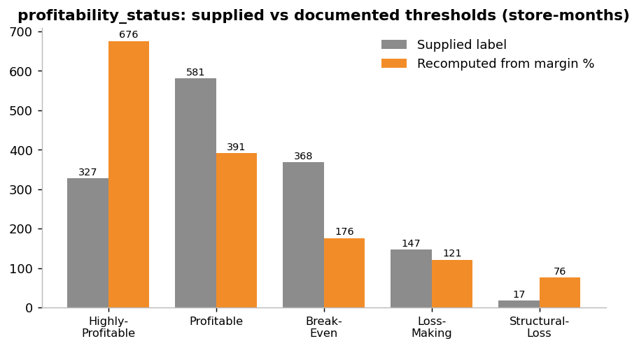

### 3.3 Why the daily table must not be summed

`fact_daily_sales` revenue per row averages about £2,000, but each store trades about £2,050 a day, and only one in five store-days is present. Treat it as a representative sample for patterns (weekday, calendar, mix, basket size) and use the monthly fact for every £ total.

---

## 4. Estate overview

| Metric | 2023 | 2024 | Two-year total |
|---|---:|---:|---:|
| Revenue | £44.98m | £44.70m | **£89.69m** |
| Store-level net profit | £8.47m | £8.41m | **£16.88m** |
| Net margin | 18.84% | 18.80% | **18.82%** |

**Cost structure (% of revenue):** COGS 37.9% · staffing 31.0% · rent 10.4% · loyalty redemption 1.9% · **net margin 18.8%**.

- Revenue slipped 0.6% year on year and margin was flat, so the estate is **stable, not growing**.
- Beneath that, 31 stores improved and 29 declined; typical swings are ±£50k per store. Biggest movers: Belfast Yard (+£117k), Liverpool Collective (+£116k), Bristol Station (−£141k), South London Corner (−£108k).
- Revenue per store is remarkably uniform (£56k-£71k a month). **Profit differences come from costs, not sales.**

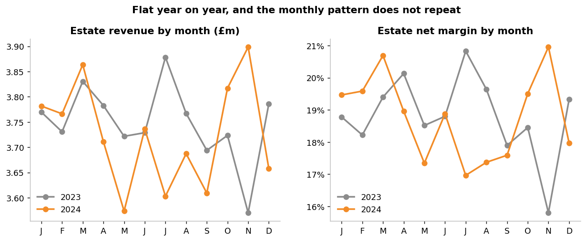

---

## 5. Findings

### Finding 1: Costs, not sales, separate good stores from bad ones (D1, D3)

- Staffing as a share of revenue has a **−0.83 correlation** with store margin and alone explains **69%** of the variation between stores. Adding rent share takes it to 99%, which is partly an accounting identity, because gross margin and loyalty cost barely vary by store. The practical point is that the variation lives in two cost lines.
- Revenue per store tells you almost nothing about margin (r = +0.23), and rent is almost unrelated to revenue (r = +0.15). Higher rent buys no extra sales.
- Splitting stores into rent quartiles at the same revenue (about £61-63k a month):

| Rent quartile | Avg monthly rent | Avg monthly revenue | Net margin |
|---|---:|---:|---:|
| Q1 (lowest) | £3.7k | £61k | **22.4%** |
| Q2 | £4.9k | £63k | 20.3% |
| Q3 | £6.8k | £63k | 17.4% |
| Q4 (highest) | £10.4k | £63k | **14.8%** |

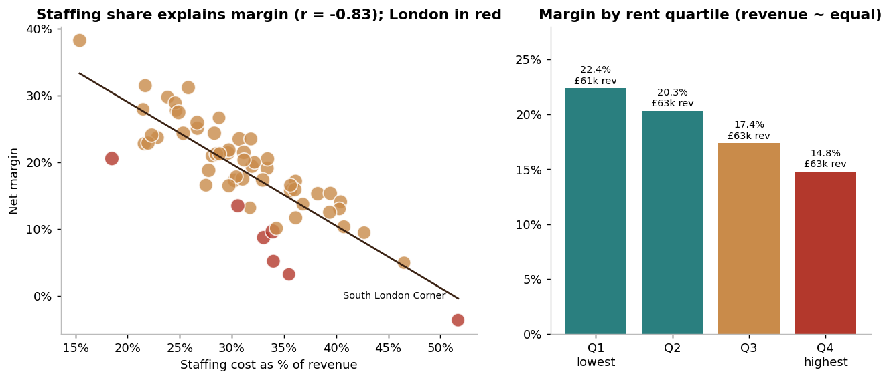

**So what:** For 2025 site selection, rent-to-revenue and the staffing model are the screening criteria. Pay more for a site only if there is evidence it earns more.

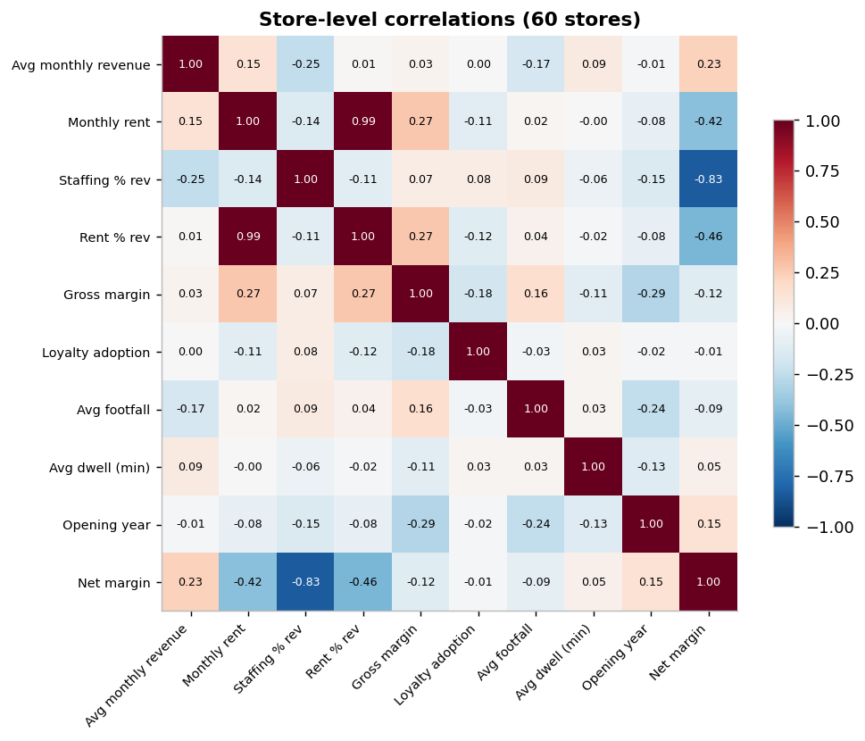

### Finding 2: London is a rent problem; a handful of other stores are a labour problem (D1, D3)

| Region | Stores | Margin | Rent % of revenue | Staffing % of revenue | Loss store-months (recomputed) |
|---|---:|---:|---:|---:|---:|
| **London** | 7 | **8.5%** | **18.9%** | 33.6% | **29%** |
| North-West | 5 | 16.1% | 8.0% | 35.9% | 18% |
| South-West | 5 | 16.2% | 11.3% | 33.1% | 19% |
| ... | | | | | |
| West-Midlands | 3 | 24.5% | 6.6% | 29.2% | 13% |
| Northern-Ireland | 3 | 28.4% | 7.3% | 24.3% | 8% |

(Full table in `data/derived/metrics.json`. "Loss store-months" = Loss-Making plus Structural-Loss using recomputed status.)

- London stores earn the same revenue as everyone else but pay **£11.7k average monthly rent against £6.5k** for the estate (1.8×). Rent takes 18.9% of London revenue against 10.4% for the chain.
- London accounts for 17 of the 76 Structural-Loss store-months (22%) with 12% of stores.
- **If London matched the margin of the other 53 stores (20.2%), profit would be about £0.61m a year higher.**
- Outside London, the problem stores are **labour-led**: South London Corner (staffing 51.7% of revenue), Manchester Collective (46.5%) and Nottingham Quarter (42.7%) against a 31% average.

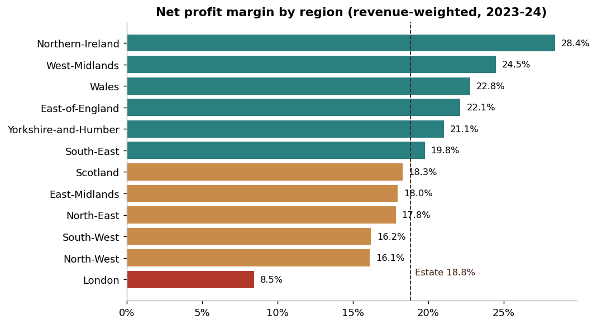

*Caveat:* Regions contain only 3 to 7 stores each, so region rankings can move on one store. Location type (12 to 30 stores) is a safer basis for planning.

| Location type | Stores | Margin | Rent % | Staffing % |
|---|---:|---:|---:|---:|
| Train-Station (2 stores) | 2 | 25.1% | 8.9% | 26.0% |
| Shopping-Centre | 12 | **22.3%** | 10.3% | 27.6% |
| Suburban-High-Street | 16 | 20.3% | 9.0% | 30.9% |
| City-Centre | 30 | **16.1%** | 11.3% | 32.8% |

City-Centre is half the estate and the lowest-margin location type. Train-Station looks strongest but is two stores in one town, so it should not drive an expansion decision.

### Finding 3: Nine stores need review, and they have two different problems (D3)

Priority review = net margin below 10% **or** six or more loss-making months (of 24). Watch = margin below 14% or a profit fall above £75k.

| Store | Region | Margin | Loss months | Staffing % | Rent % | Main driver | Staffing gap to median (£/yr) |
|---|---|---:|---:|---:|---:|---|---:|
| South London Corner | London | **−3.6%** | 13 | **51.7%** | 13.3% | Staffing | £144k |
| Canary Wharf Express | London | 3.2% | 12 | 35.5% | **21.8%** | Rent | £31k |
| Manchester Collective | North-West | 4.9% | 8 | **46.5%** | 8.1% | Staffing | £106k |
| North London Yard | London | 5.1% | 7 | 34.0% | **20.4%** | Rent | £22k |
| Canary Wharf Quarter | London | 8.7% | 7 | 33.0% | **19.8%** | Rent | £16k |
| Nottingham Quarter | East Midlands | 9.4% | 5 | **42.7%** | 8.1% | Staffing | £83k |
| East London Lounge | London | 9.6% | 7 | 33.9% | **17.2%** | Rent | £26k |
| Exeter Express | South-West | 10.1% | 9 | 34.3% | 15.3% | Rent | £25k |
| Derby Lounge | East Midlands | 15.7% | 6 | 35.6% | 9.3% | Staffing | £36k |

- **Rent-led (5 stores, 4 in London):** a lease problem. The lever is renegotiation, sub-letting or exit at lease break, not operations.
- **Labour-led (4 stores):** an operations problem. The lever is rota design and hours, which is faster and cheaper to fix than a lease.
- Bringing the nine stores to the estate margin would be worth about **£0.76m a year**.
- Ten more stores sit on the watch list, led by Bristol Station (profit −£141k year on year despite a 26.6% margin) and Chester House (−£92k).
- Manchester Collective is marked *Temporarily-Closed* yet shows 24 months of trading; check status before acting on it.

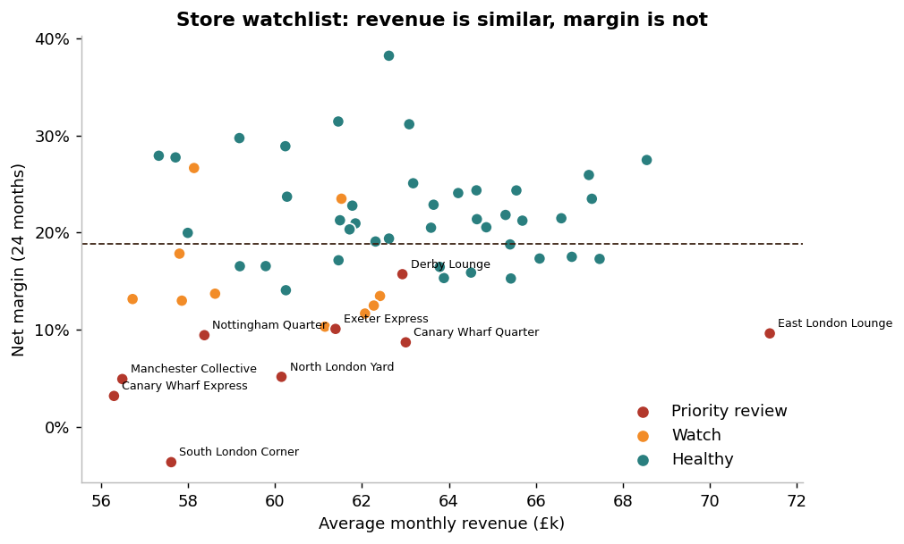
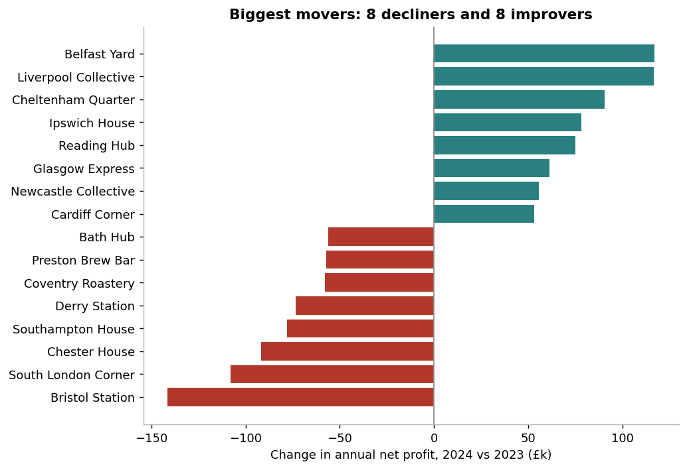

### Finding 4: Loyalty shows no measurable spend uplift (D2)

- **Members behave exactly like non-members.** Across 60 stores, member share of revenue tracks adoption rate almost perfectly (r = 0.998). A "member spend multiple" of 1.00 means members spend the same per head as everyone else; the estate average is **1.00** (range 0.72-1.21, no link to adoption).
- **Basket size is flat** across adoption quartiles: £7.28, £7.29, £7.29, £7.26 (revenue ÷ transactions). Daily ATV has essentially zero correlation with loyalty share of transactions (r = −0.002).
- **Margin is unrelated to adoption** (r = −0.01).
- **The programme costs £1.73m over two years** (1.9% of revenue, about £0.87m a year).
- **Break-even test:** after redemptions, members would have to spend about **+10.3%** more per head than they otherwise would for the programme to pay for itself at gross-margin level. The data shows about 0%.
- The brief's "net value" (member revenue minus redemption) is positive for all 60 stores (£28.0m in total), but it counts every member pound as incremental, which this data does not support.
- Low-adoption stores (around 11% adoption) give away **18.4p of redemption per £1 of member revenue**, against 3.6p in the highest-adoption stores, because redemption cost does not scale with adoption (issue 12).

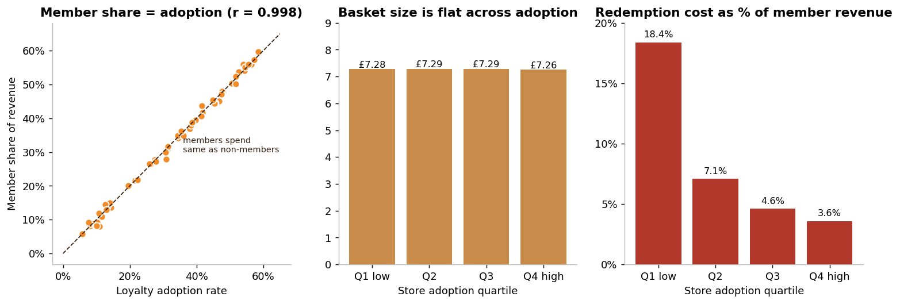
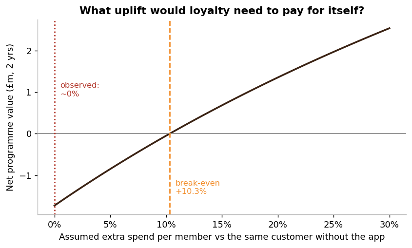

**So what:** Do not scale the programme on current evidence. Run a controlled test (matched stores, holdout, member-level frequency data) to measure real incrementality.
**Limit:** Without member-level data or a pre-programme baseline, the data cannot prove incrementality either way. It shows no visible uplift in spend per head. Loyalty may still help retention or visit frequency, which this data cannot see.

### Finding 5: Mix is stable and food is not growing (D1, D4)

- Revenue mix of tracked categories: **Espresso 45.7%, Food 26.1%, Filter 19.2%, Retail beans 9.1%**.
- 2023 to 2024: food 26.2% to 25.9%; beans 8.9% to 9.2%. The monthly food-share trend is not statistically distinguishable from flat (t = −1.2).
- Mix is almost identical across location types.
- By catalogue margin: Filter 88%, Espresso 84%, Cold Drinks 81%, Food 74%, Merchandise 70%, Retail Beans 68%. Beans sell at the highest price (£14.48) with the lowest margin.

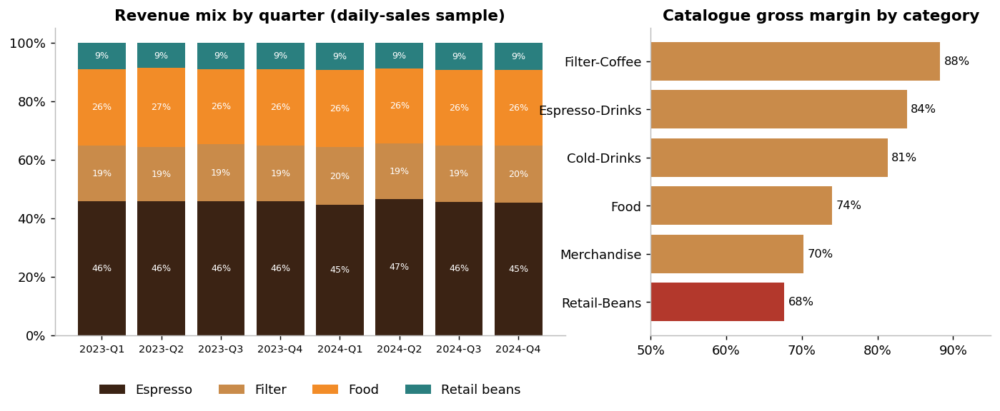

**So what:** There is no emerging category to bet on. Gains come from cost control, not mix shift.

### Finding 6: Plan for the week, not the season (D4)

- **Weekends are 24% lower** than weekdays (£1,661 vs £2,196 per store-day). It is footfall, not basket or conversion: weekend footfall is about 303 vs 400, while conversion stays about 75% and ATV about £7.48.
- Mondays are slightly softer (£2,121 vs £2,200-£2,230 Tuesday to Friday).
- **Bank holidays are 34% below a standard trading day** (£1,347 vs £2,054), and 38% below other weekdays. They hurt even the Train-Station stores (−30%, only 8 observations). Christmas period and school holidays trade at about normal levels.
- **There is no reliable seasonality.** Quarterly margin ranges 17.3%-19.9%, and the same month in 2023 and 2024 is *negatively* correlated (r = −0.52). November was the worst month in 2023 (15.8% margin) and the best in 2024 (21.0%).

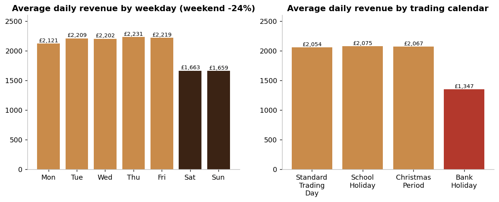
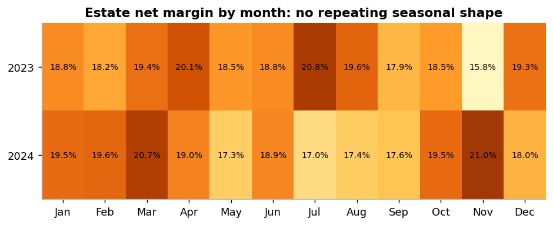

**So what:** Weekend and bank-holiday rotas are the staffing lever. Labour is 31% of revenue and the biggest controllable cost, and it does not need to match weekday hours on days when revenue is 24% to 34% lower.

---

## 6. Recommendations (sized, with owners)

| # | Action | Value at stake | Owner | Confidence |
|---|---|---|---|---|
| 1 | **Fix the four labour-led stores first** (South London Corner, Manchester Collective, Nottingham Quarter, Derby Lounge) with a rota and hours review | About £0.37m a year to reach the median staffing ratio | Operations | Strong |
| 2 | **Open lease reviews for the five rent-led stores** (Canary Wharf ×2, North London Yard, East London Lounge, Exeter) | Part of the £0.61m London gap; renegotiate at lease break | Property | Strong |
| 3 | **Add rent-to-revenue and staffing screens to 2025 site selection** (e.g. rent under ~10% of expected revenue) | Q4 vs Q1 rent stores: 7.6 pts of margin | Expansion | Strong |
| 4 | **Pause loyalty expansion; run a controlled holdout test** before further investment | £0.87m a year at stake | Marketing / Data | Moderate |
| 5 | **Flex weekend and bank-holiday rotas** to the 24% / 34% demand drop | Staffing to median across 30 above-median stores is about £1.17m a year (upper bound, overlaps with #1) | Operations | Strong |
| 6 | **Do not build strategy on seasonality or format** | Avoids misallocated effort | Planning | Strong |

The £ figures are illustrative upper bounds and **overlap**; they are not additive.

---

## 7. Limitations & next steps

- Store-level profit excludes central overheads.
- Region and format samples are small (3-7 stores per region, 2 hubs).
- The daily table is a 20% sample with unreliable product fields.
- No member-level data, so loyalty incrementality is untestable.
- Two years of data cannot establish seasonality with confidence; the pattern may simply be noise around a flat trend.
- **Next:** obtain full daily sales, member-level transactions, lease-break dates and central cost allocations.

---

## 8. Metric definitions

| Metric | Definition |
|---|---|
| Net margin % | Σ net profit ÷ Σ revenue (revenue-weighted, never an average of row percentages) |
| Staffing % / Rent % | Σ cost ÷ Σ revenue |
| Gross margin % (P&L) | 1 − Σ COGS ÷ Σ revenue |
| Recomputed status | >20% Highly-Profitable · 8-20% Profitable · −2 to 8% Break-Even · −15 to −2% Loss-Making · below −15% Structural-Loss |
| Loss store-months | Recomputed status in {Loss-Making, Structural-Loss} |
| Member spend multiple | (member share ÷ (1 − member share)) ÷ (adoption ÷ (1 − adoption)); 1.0 = members spend the same per head |
| Break-even uplift | k ÷ (1 − k), where k = redemption cost ÷ (member revenue × P&L gross margin) |
| ATV | Σ revenue ÷ Σ transactions |
| Annualised £ | Two-year total ÷ 2 |
